# Mini-CRM - Gestion clients & contrats


-4479A1?logo=mysql&logoColor=white)


Application web de **gestion de clients et de contrats** : un portefeuille clients, des contrats rattachés avec leur montant et leur période, un tableau de bord qui **fait remonter les échéances à 30 jours**, des rôles Administrateur / Lecture seule et un **journal d'audit qui consigne automatiquement chaque modification**, champ par champ. Le tout dans une interface conçue comme un produit fini : identité visuelle propre, animations sobres, responsive du smartphone au grand écran, accessible au clavier.

[](#9-les-écrans)
[](#14-reproduire-le-projet)

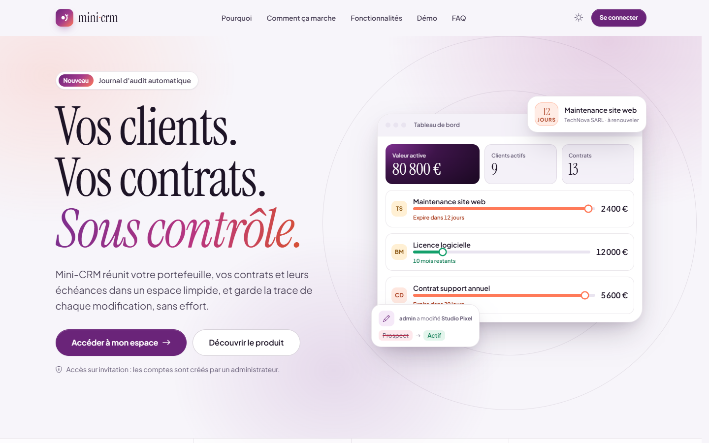

*La vitrine publique (« / » pour un visiteur non connecté) : la proposition de valeur, l'accès à l'espace et un aperçu du produit dont les calques réagissent légèrement au curseur. Chaque contrat y montre sa durée de vie, du début à la fin, avec le repère « aujourd'hui ».*

---

## Sommaire

1. [Le projet en bref](#1-le-projet-en-bref)
2. [Les résultats en bref](#2-les-résultats-en-bref)
3. [Contexte et objectifs](#3-contexte-et-objectifs)
4. [Problématiques traitées](#4-problématiques-traitées)
5. [Données utilisées](#5-données-utilisées)
6. [Outils et technologies](#6-outils-et-technologies)
7. [Méthodologie](#7-méthodologie)
8. [Étapes de réalisation](#8-étapes-de-réalisation)
9. [Les écrans](#9-les-écrans)
10. [Règles métier en détail](#10-règles-métier-en-détail)
11. [Utilisation au quotidien](#11-utilisation-au-quotidien)
12. [Principaux enseignements](#12-principaux-enseignements)
13. [Structure du projet](#13-structure-du-projet)
14. [Reproduire le projet](#14-reproduire-le-projet)
15. [Limites et pistes d'amélioration](#15-limites-et-pistes-damélioration)
16. [Crédits](#16-crédits)

---

## 1. Le projet en bref

> **En une phrase :** j'ai construit un CRM léger qui centralise clients et contrats, signale les échéances avant qu'elles ne tombent et garde la trace de chaque modification, sans qu'aucune ligne de code métier n'ait à y penser.

### La situation

Dans une petite structure commerciale, les clients vivent dans un tableur, les contrats dans un autre, et les dates de fin dans la mémoire de quelqu'un. On découvre un contrat expiré quand le client appelle ; on ne sait plus qui a changé le statut d'un prospect, ni quand. Rien de difficile, mais **rien n'est relié, rien n'est tracé, et tout dépend de la vigilance d'une personne**.

### Ce que j'ai fait

| Étape | En pratique |
|---|---|
| **Modéliser** | Clients, contrats (montant, période, statut), secteurs d'activité, utilisateurs et journal d'audit, en base MySQL via Entity Framework Core |
| **Séparer les responsabilités** | Controllers fins, logique métier dans des services (pattern interface + service), vues Razor et fragments AJAX |
| **Sécuriser l'accès** | ASP.NET Core Identity, toutes les routes protégées par défaut, rôles Admin / User, verrouillage après 5 échecs |
| **Tracer sans y penser** | Un intercepteur EF Core journalise chaque `SaveChanges` : création, modification (avant → après), suppression |
| **Faire remonter l'urgent** | Contrats actifs expirant sous 30 jours, contrats actifs dont la date de fin est dépassée, répartition par statut |
| **Concevoir l'interface comme un produit** | Design system maison (tokens, composants), système d'animation unique, identité visuelle « Prune », thème clair et sombre |
| **Adapter à chaque support** | Dock flottant sur ordinateur, rail d'icônes sur tablette, barre d'onglets sur mobile ; tableaux transformés en cartes |
| **Vérifier** | 78 tests unitaires xUnit (services, intercepteur d'audit, règles de présentation), parcours vérifiés dans un vrai navigateur |

### Ce que ce projet démontre

- **Architecture propre** : controllers fins, services testables, intercepteur transversal pour l'audit, un helper de présentation unique pour toutes les vues.
- **Sens du métier** : l'outil ne se contente pas de stocker ; il signale ce qui demande une action (échéance proche, contrat actif échu).
- **Sécurité par défaut** : authentification obligatoire partout, rôles, anti-CSRF, anti-force brute, en-têtes HTTP durcis, export CSV protégé contre l'injection de formules.
- **Soin du produit** : interface sans framework CSS, avec ses propres tokens, ses composants à états (chargement, succès, erreur) et un motion design qui explique plutôt qu'il ne décore.
- **Accessibilité** : navigation complète au clavier, focus visible, fenêtres `<dialog>` natives, statuts jamais signalés par la seule couleur.
- **Rigueur** : 78 tests, validation côté serveur et côté client alignées, comportement vérifié sur bureau, tablette et mobile, en thème clair et sombre.

### Pour découvrir le travail en 2 minutes

1. Regarder [les écrans](#9-les-écrans).
2. Lancer l'application ([section 14](#14-reproduire-le-projet)) et se connecter avec le bouton **Administrateur** de l'écran de connexion.
3. Sur le **tableau de bord**, survoler la légende de l'anneau pour isoler un statut.
4. Dans **Contrats**, filtrer par statut et observer la barre de durée de vie de chaque contrat.
5. Ouvrir une fiche client, la modifier, puis consulter le **journal d'audit** : la modification y figure, champ par champ.

## 2. Les résultats en bref

**Le constat.** Les informations commerciales étaient dispersées et les échéances suivies de mémoire. Mini-CRM les réunit dans un seul espace et **signale de lui-même** ce qui demande une action.

**Ce que l'outil apporte**

1. **Des échéances anticipées** : les contrats actifs qui expirent sous 30 jours remontent sur le tableau de bord avec un compte à rebours ; ceux dont la date de fin est dépassée sont signalés à part.
2. **Une traçabilité complète et gratuite** : chaque création, modification ou suppression est consignée avec son auteur, l'heure et le détail « avant → après », sans appel manuel dans le code.
3. **Un travail sans friction** : recherche instantanée, filtres, édition dans un panneau latéral, export CSV, le tout sans recharger la page.

**Les livrables**

| Livrable | Lien |
|---|---|
| Application ASP.NET Core MVC | [Program.cs](Program.cs), [Controllers/](Controllers/), [Services/](Services/) |
| Intercepteur d'audit automatique | [Data/AuditSaveChangesInterceptor.cs](Data/AuditSaveChangesInterceptor.cs) |
| Design system (tokens, composants) | [wwwroot/css/](wwwroot/css/) |
| Système d'animation et interactions | [wwwroot/js/](wwwroot/js/) |
| Données de démonstration | [Data/SeedData.cs](Data/SeedData.cs) |
| Tests unitaires (78) | [MiniCrm.Tests/](MiniCrm.Tests/) |
| Captures de l'application | [docs/images/](docs/images/) |

## 3. Contexte et objectifs

**Le contexte.** Projet réalisé dans le cadre d'un entretien technique : concevoir un mini-CRM complet en ASP.NET Core MVC, de la base de données à l'interface.

**Scénario.** Une petite entreprise de services suit une dizaine de clients et une vingtaine de contrats. L'objectif est de fournir un outil qui :

- **centralise** clients, contrats et secteurs d'activité ;
- **anticipe** les fins de contrat plutôt que de les subir ;
- **trace** qui a fait quoi, et ce qui a changé ;
- **distingue** ceux qui consultent de ceux qui modifient ;
- **reste agréable** à utiliser tous les jours, sur ordinateur comme sur téléphone.

**Trois scénarios types**, imaginés pour illustrer le projet :

| Profil | Besoin | Ce que fait Mini-CRM |
|---|---|---|
| Sophie, gérante | « Je veux savoir en arrivant le matin quels contrats arrivent à échéance. » | Le tableau de bord affiche les échéances à 30 jours avec un compte à rebours, et alerte sur les contrats actifs déjà échus |
| Karim, commercial | « Je consulte les fiches avant un rendez-vous, depuis mon téléphone. » | Compte en lecture seule, navigation par onglets sur mobile, fiche client complète avec ses contrats |
| Inès, assistante administrative | « On m'a demandé qui a passé ce client en inactif, et quand. » | Le journal d'audit montre l'auteur, l'heure et le changement « Actif → Inactif » |

## 4. Problématiques traitées

| # | Question | Partie prenante |
|---|---|---|
| 1 | Comment réunir clients et contrats, et retrouver une fiche en quelques secondes ? | Commerciaux |
| 2 | Comment voir venir les fins de contrat au lieu de les découvrir trop tard ? | Direction |
| 3 | Comment savoir qui a modifié quoi, sans compter sur la discipline de chacun ? | Administration |
| 4 | Comment ouvrir l'outil en consultation sans risquer des modifications ? | Direction |
| 5 | Comment exporter les données sans exposer l'entreprise à une injection de formule dans Excel ? | Comptabilité |
| 6 | Comment rendre l'outil utilisable partout : bureau, tablette, téléphone, clavier seul ? | Tous |

**Règle centrale : un contrat « expire bientôt » s'il est actif et que sa date de fin tombe dans les 30 prochains jours.** Un contrat actif dont la date de fin est déjà passée est signalé à part : il doit être renouvelé ou passé en « Expiré ».

## 5. Données utilisées

| Élément | Détail |
|---|---|
| Comptes | 1 administrateur et 1 utilisateur en lecture seule, créés au premier démarrage |
| Clients | 10 clients d'exemple (boulangerie, cabinet d'avocats, garage, pharmacie, studio de design…) aux statuts Actif, Inactif et Prospect |
| Contrats | 20 contrats répartis sur tous les statuts, dont 3 qui expirent sous 30 jours au moment du premier démarrage |
| Secteurs | Catalogue déduit des clients d'exemple (Agroalimentaire, Informatique, Juridique, Santé…) |
| Nature | Données fictives, générées par [`SeedData.cs`](Data/SeedData.cs) avec des dates relatives au jour du premier lancement |

### Modèle de données

| Entité | Champs principaux | Règles |
|---|---|---|
| `Client` | `Name`, `Email`, `Sector`, `Status` (Active, Inactive, Prospect), `CreatedAt` | Nom et email obligatoires, email valide |
| `Contract` | `Title`, `Amount`, `StartDate`, `EndDate`, `Status` (Active, Expired, Cancelled, Draft), `ClientId` | Montant positif ; suppression en cascade avec le client |
| `Sector` | `Name` | Unique (insensible à la casse) ; un renommage se propage aux clients |
| `AuditLog` | `Timestamp`, `UserName`, `UserRole`, `Action`, `EntityType`, `EntityId`, `EntityLabel`, `Details` | Détail multi-lignes « Champ : « avant » → « après » », tronqué à 500 caractères |

## 6. Outils et technologies

| Outil | Utilisation dans le projet |
|---|---|
| **ASP.NET Core MVC (.NET 10)** | Application web : controllers, vues Razor, fragments renvoyés aux requêtes AJAX |
| **Razor Pages + ASP.NET Core Identity** | Connexion, rôles, verrouillage de compte ; inscription publique désactivée |
| **Entity Framework Core 10** | ORM, migrations, intercepteur `SaveChanges` pour l'audit |
| **MySQL (WAMP)** via `MySql.EntityFrameworkCore` | Base de données locale ; provider officiel d'Oracle, seul compatible EF Core 10 à l'écriture du projet |
| **HTML, CSS, JavaScript** | Interface sans framework : design system à base de tokens, composants, système d'animation, `<dialog>` natifs, validation en ligne |
| **View Transitions API** | Transitions entre pages et changement de thème, avec repli automatique |
| **Bootstrap Icons** | Jeu d'icônes (seule ressource externe avec les polices) |
| **xUnit + EF Core InMemory** | 78 tests unitaires, sans dépendance à MySQL |
| **ngrok** | Tunnel HTTPS pour une démonstration à distance |
| **Git / GitHub** | Versionnage, branches `main` et `dev` |

## 7. Méthodologie

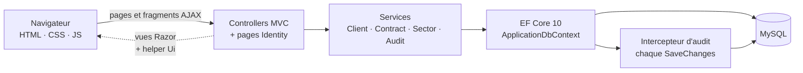

Trois principes ont guidé le travail :

1. **Des controllers fins** : ils valident, délèguent au service et choisissent la réponse (page complète, fragment AJAX ou JSON). Toute la logique métier vit dans les services, ce qui la rend testable sans serveur web.
2. **Les préoccupations transversales au bon endroit** : l'audit ne dépend d'aucun appel manuel ; il est accroché à EF Core. Une nouvelle fonctionnalité qui modifie un client est tracée sans code supplémentaire.
3. **Une interface qui fonctionne sans JavaScript, puis s'améliore** : chaque action a sa page autonome (création, édition, suppression, fiche) ; avec JavaScript, elle s'ouvre dans une fenêtre ou un panneau, sans rechargement.

## 8. Étapes de réalisation

### 8.1 Modèle et base de données

- Entités `Client`, `Contract`, `Sector`, `AuditLog` et utilisateurs Identity dans un même `DbContext`.
- MySQL avec `utf8mb4` : les colonnes indexées sont bornées à 191 caractères pour rester sous la limite d'index d'InnoDB.
- Migrations appliquées et données de démonstration créées automatiquement au démarrage.

### 8.2 Services métier

- `ClientService`, `ContractService`, `SectorService`, `AuditService` derrière leurs interfaces, injectés par conteneur.
- Recherche et pagination côté base ; filtre par statut des contrats ; secteur créé à la volée si l'utilisateur choisit « Autre… » dans le formulaire client ; renommage d'un secteur propagé à tous les clients concernés.

### 8.3 Authentification et rôles

- `FallbackPolicy` : toute route exige une connexion, sauf la vitrine, la connexion et les fichiers statiques.
- Actions sensibles restreintes par `[Authorize(Roles = "Admin")]` ; côté interface, un utilisateur en lecture seule voit les boutons mais reçoit une fenêtre « Accès réservé ».
- Verrouillage de 15 minutes après 5 échecs de connexion ; comptes créés uniquement par un administrateur.

### 8.4 Journal d'audit automatique

- `AuditSaveChangesInterceptor` (portée *scoped*, car il garde un état par requête) relève les entités ajoutées, modifiées et supprimées avant l'enregistrement (`SavingChanges`), puis écrit les entrées d'audit une fois l'enregistrement réussi (`SavedChanges`).
- Pour une modification, chaque champ changé produit une ligne `Nom : « client_test » → « client_test_mod »`.
- Les créations et suppressions d'utilisateurs sont journalisées explicitement par `UserController`.

### 8.5 Interface : identité « Prune »

L'interface a été entièrement conçue pour ce projet, sans Bootstrap ni jQuery, avec une identité distincte des autres projets du portfolio.

**Identité visuelle** ([`tokens.css`](wwwroot/css/tokens.css))
- Encre prune profonde, porcelaine lilas, un accent corail réservé aux échéances et au temps qui passe.
- Titres en *Instrument Serif* (éditoriale, italique pour les mots clés), interface en *Plus Jakarta Sans*.
- Thème clair et thème sombre composés séparément ; le thème suit le système, un bouton permet de basculer et le choix est mémorisé.

**Design system** ([`components.css`](wwwroot/css/components.css))
- Une seule source de vérité pour les couleurs, la typographie fluide (`clamp()`), les espacements (4 à 128 px), les rayons, les ombres et les plans.
- Composants réutilisables : bouton (survol, actif, focus, désactivé, chargement, succès), champ (normal, focus, erreur, validé, désactivé), statut, pastille de filtre, contrôle segmenté, cartes de choix, tableau, pagination, modale, tiroir latéral, feuille mobile, notification, squelette de chargement, état vide.
- **Signature métier** : la barre de *durée de vie* d'un contrat, de la date de début à la date de fin, avec le repère « aujourd'hui » et une légende en mots (« Expire dans 12 jours », « Échéance dépassée de 88 jours »).

**Système d'animation** ([`core.js`](wwwroot/js/core.js) et tokens `--dur-*`)
- Durées et courbes partagées (micro-interaction 120 ms, survol 180 ms, composant 260 ms, transition 400 ms, animation complexe 700 ms), amplitudes plafonnées à 24 px, uniquement en `transform` et `opacity`.
- Révélation au défilement avec décalage hiérarchique (titre, puis description, puis action), indicateurs qui comptent jusqu'à leur valeur, anneau de répartition qui se dessine.
- Transitions entre pages (View Transitions) : la navigation reste fixe et l'indicateur de la page active glisse d'un lien à l'autre.
- Effets liés au curseur (halo sur les cartes, légère parallaxe, boutons magnétiques de quelques pixels) réservés à la souris.
- Avec `prefers-reduced-motion`, plus rien ne bouge : le contenu s'affiche directement dans son état final.

**Interactions**
- Création et suppression dans une modale, consultation et édition dans un tiroir latéral qui devient une feuille montante sur mobile.
- Validation en ligne qui lit directement les attributs `data-val-*` générés par ASP.NET Core : mêmes règles, mêmes messages qu'au serveur, erreurs au plus près du champ, saisies conservées.
- Recherche instantanée (raccourci <kbd>/</kbd>), filtres par statut, pagination fenêtrée, export CSV qui suit les filtres en cours, copie d'un email en un clic.

**Accessibilité et responsive**
- Navigation complète au clavier, lien d'évitement, focus visible, fenêtres `<dialog>` natives (focus piégé, Échap), retour du focus sur l'élément d'origine.
- Statuts toujours signalés par une icône **et** un libellé, jamais par la seule couleur ; contrastes vérifiés (AA).
- Trois navigations selon le support : dock flottant (ordinateur), rail d'icônes (tablette), barre d'onglets et feuille de menu (mobile) ; aucun débordement horizontal à 375 px.
- Poids maîtrisé : aucun framework, environ 92 Ko de CSS et 38 Ko de JavaScript maison (non minifiés) pour l'application.

### 8.6 Sécurité

| Menace | Protection |
|---|---|
| Force brute | Verrouillage du compte 15 minutes après 5 échecs |
| CSRF | Jeton anti-forgery validé sur tous les formulaires POST, y compris en AJAX |
| Injection SQL | Requêtes paramétrées par Entity Framework, aucune requête SQL brute |
| Injection de formule CSV (CWE-1236) | Cellules commençant par `= + - @` neutralisées avant export |
| Injection HTML dans les notifications | Messages insérés en `textContent`, jamais en HTML |
| Clickjacking, MIME sniffing | `X-Frame-Options: DENY`, `frame-ancestors 'none'`, `X-Content-Type-Options: nosniff`, `Content-Security-Policy` |
| Mots de passe | Hachés par ASP.NET Core Identity, jamais stockés en clair |

### 8.7 Contrôle qualité

| Fichier de tests | Ce qui est vérifié |
|---|---|
| [`Services/ClientServiceTests.cs`](MiniCrm.Tests/Services/ClientServiceTests.cs) | CRUD client, recherche, pagination, création automatique d'un secteur depuis le formulaire |
| [`Services/ContractServiceTests.cs`](MiniCrm.Tests/Services/ContractServiceTests.cs) | CRUD contrat, filtre par statut et recherche, export |
| [`Services/SectorServiceTests.cs`](MiniCrm.Tests/Services/SectorServiceTests.cs) | Catalogue, doublons, renommage propagé aux clients |
| [`Services/AuditServiceTests.cs`](MiniCrm.Tests/Services/AuditServiceTests.cs) | Écriture des entrées d'audit, troncature, pagination |
| [`Data/AuditSaveChangesInterceptorTests.cs`](MiniCrm.Tests/Data/AuditSaveChangesInterceptorTests.cs) | Audit automatique : création, modification, suppression détectées sans appel manuel, détails multi-lignes, pas d'audit hors authentification, pas de boucle infinie |
| [`Models/ContractTests.cs`](MiniCrm.Tests/Models/ContractTests.cs) | Calcul de `IsExpiringSoon` aux bornes de la fenêtre des 30 jours |
| [`Helpers/UiTests.cs`](MiniCrm.Tests/Helpers/UiTests.cs) | Libellés et tons des statuts, monogrammes, montants, durée de vie d'un contrat (alerte, dépassement, non démarré), lecture du journal d'audit, pagination fenêtrée |

Les tests utilisent le provider **EF Core InMemory** : ils tournent sans MySQL. L'interface a en plus été vérifiée dans un vrai navigateur : création, modification et suppression, rôles Administrateur et Lecture seule, erreurs de connexion, thèmes clair et sombre, clavier seul, bureau, tablette et mobile.

## 9. Les écrans

| Tableau de bord | Fiche client |
|---|---|
| 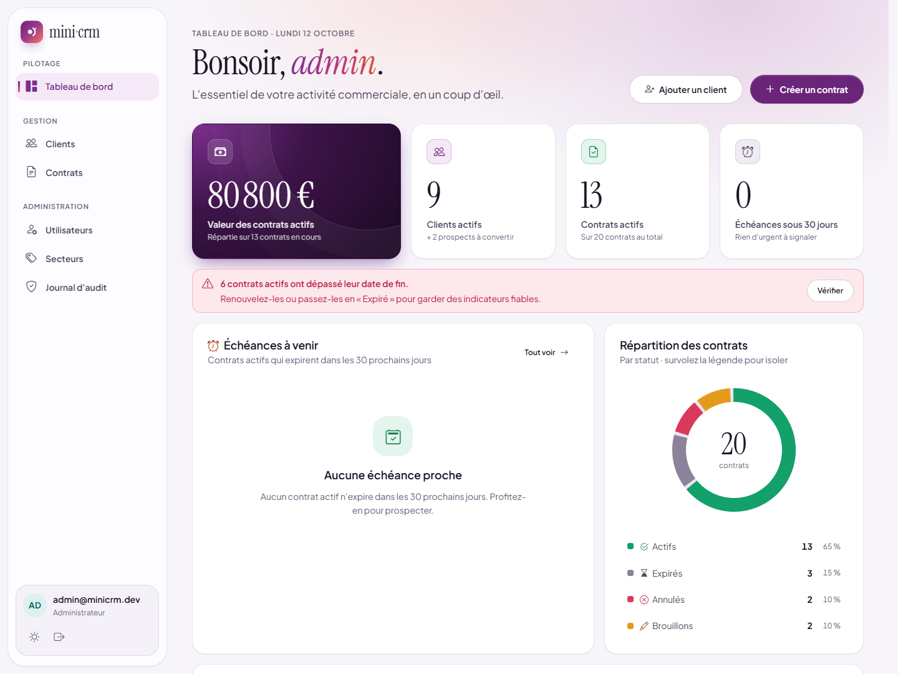 | 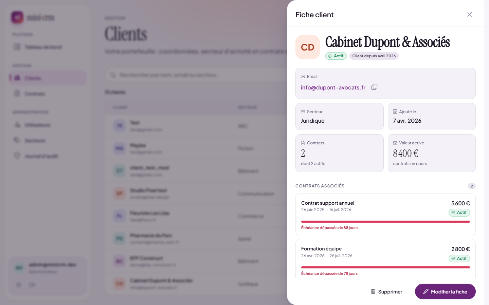 |
| **Contrats** | **Formulaire et validation** |
| 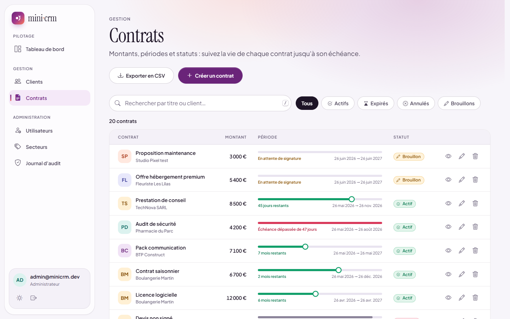 | 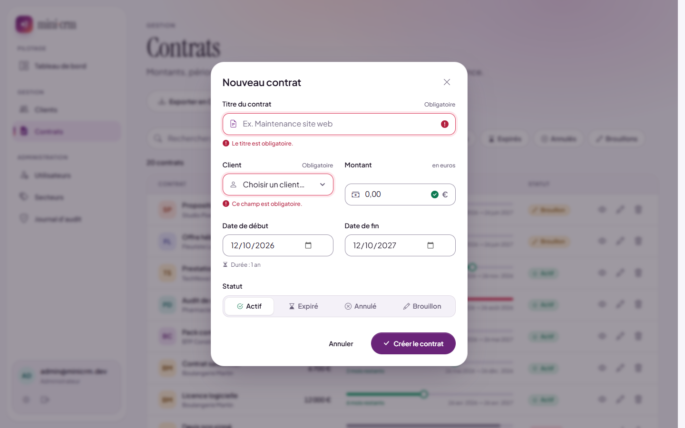 |
| **Journal d'audit** | **Thème sombre** |
| 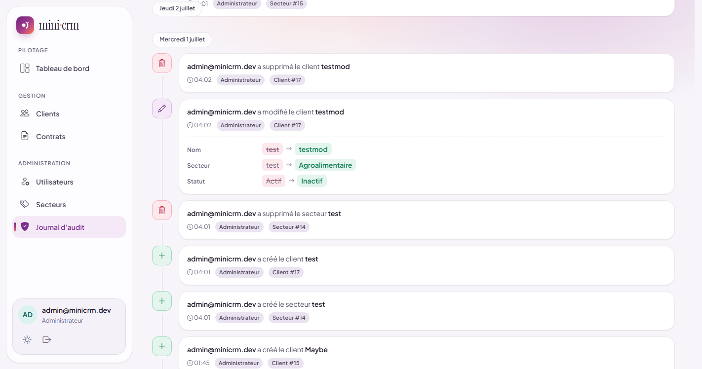 | 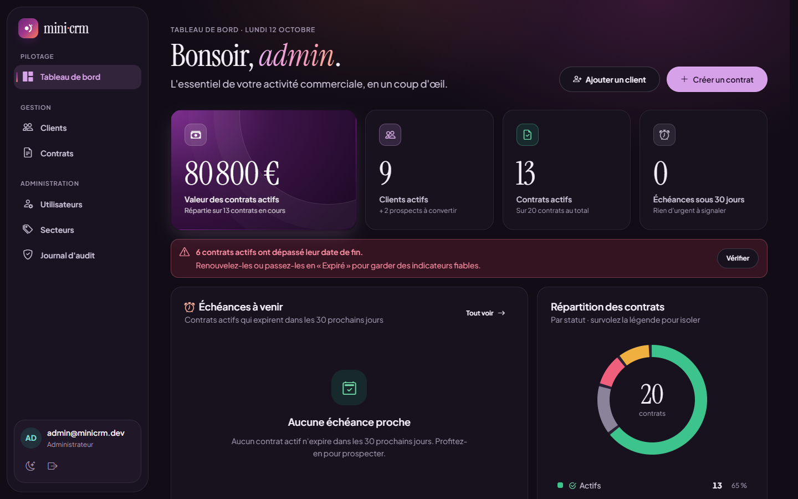 |
| **Connexion** | **Récit au défilement (vitrine)** |
| 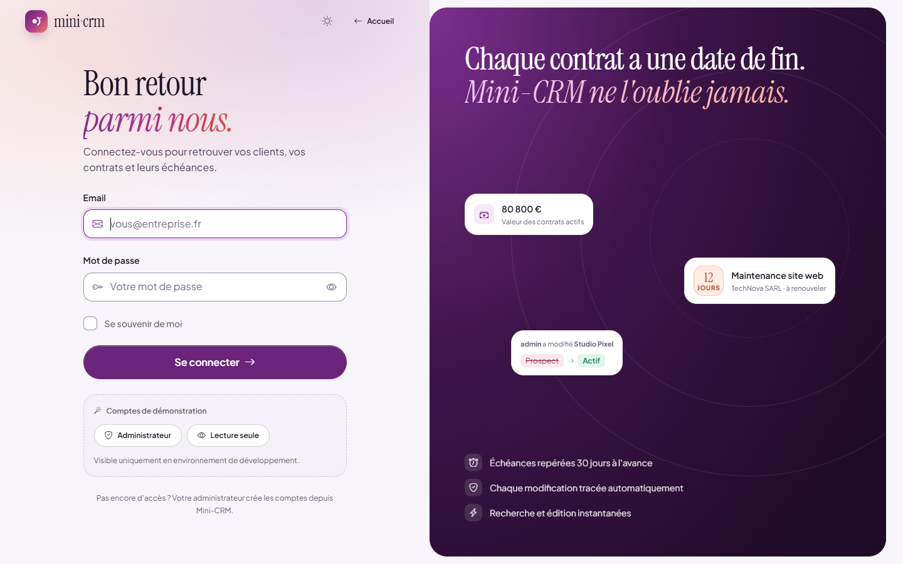 | 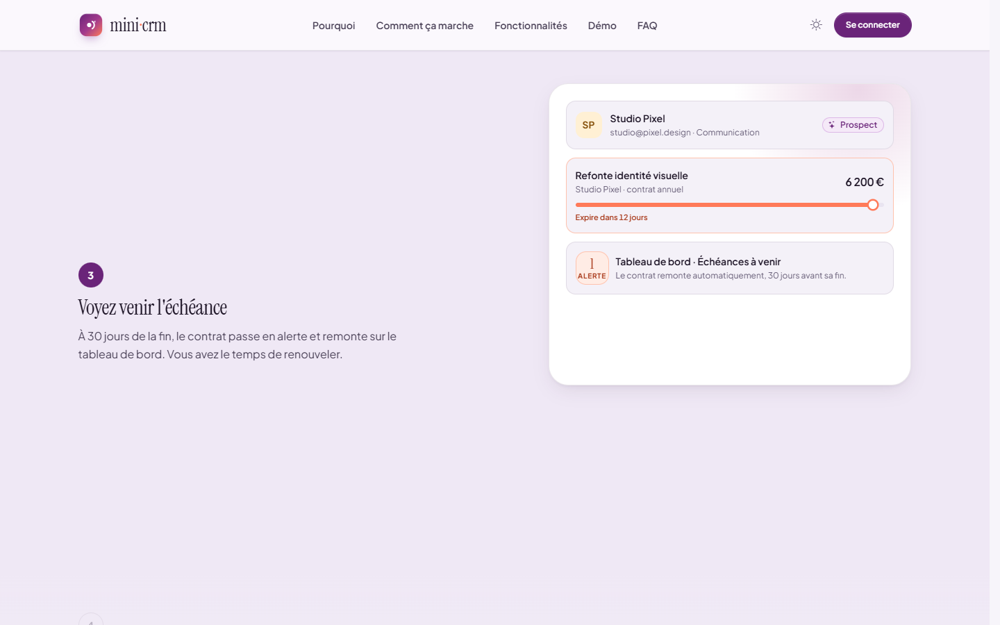 |

| Mobile : tableau de bord | Mobile : contrats |
|---|---|
| 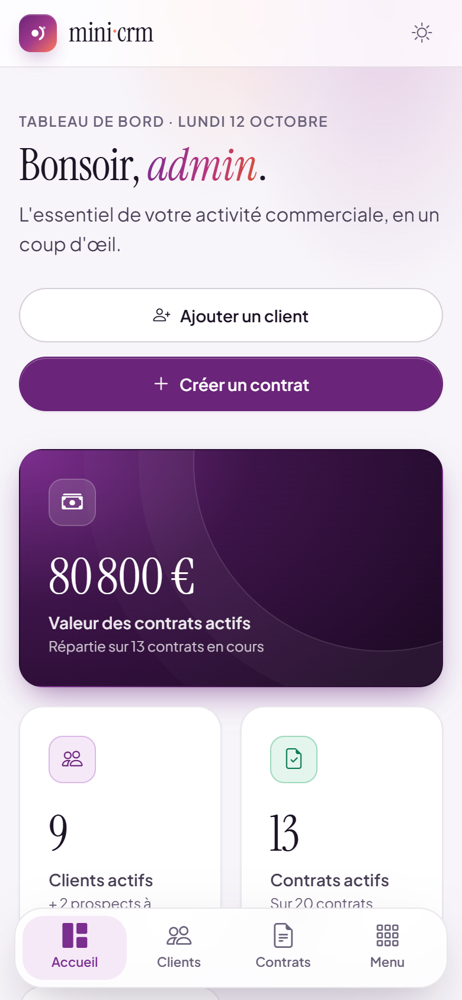 | 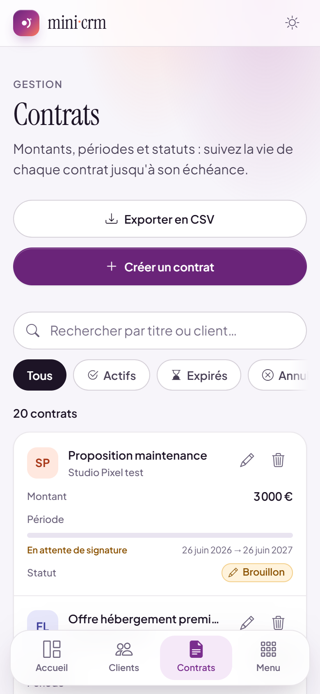 |

- **Tableau de bord** : la valeur des contrats actifs, les clients et contrats actifs, les échéances à 30 jours, l'alerte des contrats actifs échus, l'anneau de répartition (survoler la légende isole un statut) et les derniers contrats.
- **Fiche client** : coordonnées (email copiable), secteur, valeur active, contrats associés avec leur durée de vie ; les actions restent collées en bas du panneau.
- **Contrats** : recherche, filtres par statut, barre de durée de vie, export CSV ; sur mobile, chaque ligne devient une carte.
- **Formulaire** : erreurs affichées sous le champ concerné, avec une icône, durée du contrat calculée en direct (et avertissement si la fin précède le début).
- **Journal d'audit** : frise regroupée par jour, phrase lisible (« admin a modifié le client… ») et détail « avant → après » de chaque champ.

## 10. Règles métier en détail

### Durée de vie d'un contrat

La barre et sa légende sont calculées par [`Ui.LifespanOf`](Helpers/Ui.cs), testée dans [`UiTests.cs`](MiniCrm.Tests/Helpers/UiTests.cs) :

| Situation | Ton | Légende affichée |
|---|---|---|
| Actif, en cours, fin dans plus de 60 jours | vert | « 9 mois restants » |
| Actif, en cours, fin dans 31 à 60 jours | vert | « 45 jours restants » |
| Actif, fin dans 30 jours ou moins | corail (alerte) | « Expire dans 12 jours », « Expire aujourd'hui » |
| Actif, date de fin dépassée | rouge | « Échéance dépassée de 88 jours » |
| Actif, pas encore commencé | prune | « Débute dans 5 jours » |
| Brouillon | ambre | « En attente de signature » |
| Expiré | gris | « Terminé le 26 juin 2026 » |
| Annulé | gris | « Annulé » |

```csharp
if (end < day)
    return new(100, "danger", $"Échéance dépassée de {Days(-daysLeft)}", false, true);
if (start > day)
    return new(0, "info", $"Débute dans {Days((start - day).Days)}", false, false);
if (daysLeft <= 30)
    return new(percent, "alert", daysLeft == 0 ? "Expire aujourd'hui" : $"Expire dans {Days(daysLeft)}", true, false);
```

### Rôles et permissions

| Action | Admin | User |
|---|---|---|
| Consulter clients, contrats, tableau de bord | ✅ | ✅ |
| Créer, modifier, supprimer un client ou un contrat | ✅ | ❌ (fenêtre « Accès réservé ») |
| Gérer les secteurs | ✅ | ❌ |
| Créer et supprimer des utilisateurs | ✅ | ❌ |
| Consulter le journal d'audit | ✅ | ❌ |

### Export CSV

L'export suit la recherche et le filtre de statut en cours. Séparateur `;`, encodage UTF-8 avec BOM (les accents s'affichent dans Excel), et toute cellule commençant par `=`, `+`, `-` ou `@` est préfixée d'une apostrophe pour qu'un tableur ne l'exécute pas comme une formule.

## 11. Utilisation au quotidien

### Identifiants de démonstration

| Rôle | Email | Mot de passe |
|---|---|---|
| Admin | `admin@minicrm.dev` | `Admin@1234` |
| User | `user@minicrm.dev` | `User@1234` |

En environnement **Development**, l'écran de connexion propose deux boutons qui remplissent le formulaire avec ces comptes ; ils disparaissent automatiquement en production.

### Au fil de la journée

- **Le matin** : le tableau de bord indique les échéances à venir et les contrats actifs à régulariser.
- **Retrouver une fiche** : <kbd>/</kbd> place le curseur dans la recherche ; la liste se filtre à la saisie, <kbd>Échap</kbd> efface.
- **Mettre à jour** : un clic sur le nom ouvre la fiche dans un panneau latéral, « Modifier la fiche » la passe en édition.
- **Ajouter un accès** : Administration > Utilisateurs > « Créer un accès », en choisissant Utilisateur (lecture seule) ou Administrateur.
- **Vérifier une modification** : Administration > Journal d'audit.

### Exposer l'application avec ngrok

Un fichier `ngrok.yml` (non versionné, il contient un jeton personnel) définit un tunnel vers le port `5154` :

```yaml
version: "3"
agent:
  authtoken: <votre-token>
tunnels:
  minicrm:
    proto: http
    addr: 5154
```

Lancer l'application (`dotnet run`), puis dans un autre terminal `ngrok start minicrm --config ngrok.yml`. L'application respecte le schéma HTTPS transmis par le tunnel (`ForwardedHeaders`).

## 12. Principaux enseignements

**Sur l'architecture**
- **Un intercepteur vaut mieux que mille appels manuels** : en accrochant l'audit à `SaveChanges`, aucune fonctionnalité future ne peut l'oublier. Il doit en revanche vivre dans la même portée que le `DbContext` (*scoped*), car il garde un état entre « avant » et « après » l'enregistrement.
- **Des controllers fins rendent le métier testable** : la recherche, la pagination ou la propagation d'un renommage se testent sans serveur web, sur une base en mémoire.

**Sur la base de données**
- **MySQL et utf8mb4 ont leurs limites** : les clés d'Identity dépassaient la longueur d'index autorisée ; il a fallu imposer InnoDB et borner les colonnes indexées à 191 caractères.
- **Un provider se choisit selon la version d'EF Core** : Pomelo s'arrête à EF Core 9 ; le provider officiel d'Oracle était le seul compatible avec EF Core 10.

**Sur la sécurité**
- **Une politique d'authentification globale protège aussi… les fichiers CSS** : sans `AllowAnonymous()` sur les fichiers statiques, la page de connexion s'affichait sans style.
- **Un export est une surface d'attaque** : une cellule `=HYPERLINK(...)` dans un nom de client devient une formule dans Excel. Elle est neutralisée avant l'export.

**Sur l'interface**
- **Les données de démonstration vieillissent** : les contrats « qui expirent bientôt » du jeu d'essai sont devenus, quelques mois plus tard, des contrats actifs échus. L'interface le signale désormais au lieu de les ignorer.
- **Le framework parle anglais par défaut** : les champs non nullables (dates, client, statut) portent un message implicite en anglais. La validation en ligne les reconnaît et les traduit.
- **Le journal stocke des valeurs brutes** : « Active » est affiché « Actif » à la lecture, sans toucher aux données enregistrées.
- **Deux animations ne doivent pas se disputer la même propriété** : la parallaxe et l'apparition au défilement utilisaient toutes deux `transform` ; chaque effet a désormais son propre élément.
- **Une identité visuelle se décide** : ce projet a sa propre palette et sa propre typographie, pour ne pas ressembler aux autres projets du portfolio.

## 13. Structure du projet

```
MiniCrm/
├── README.md
├── Program.cs                       Pipeline, injection de dépendances, Identity, sécurité, seed au démarrage
├── appsettings.json                 Chaîne de connexion MySQL
├── Areas/Identity/Pages/Account/    Connexion, page « Accès réservé » ; inscription publique désactivée
├── Controllers/                     Home (vitrine), Dashboard, Client, Contract, Sector, User, Audit
├── Models/                          Client, Contract, Sector, AuditLog, ApplicationUser
├── ViewModels/                      PagedResult, PagerModel, DashboardViewModel, vues utilisateurs
├── Services/                        Interface + implémentation : Client, Contract, Sector, Audit
├── Helpers/Ui.cs                    Langage visuel partagé : libellés, tons, durée de vie, lecture de l'audit
├── Data/
│   ├── ApplicationDbContext.cs      DbContext (Identity + entités métier)
│   ├── AuditSaveChangesInterceptor.cs   Journalisation automatique de chaque SaveChanges
│   └── SeedData.cs                  Rôles, comptes de démonstration, clients, contrats, secteurs
├── Migrations/                      Historique des migrations EF Core
├── Views/
│   ├── Home/Index.cshtml            Vitrine publique (hero, récit au scroll, démo, FAQ)
│   ├── Dashboard/ Client/ Contract/ Sector/ User/ Audit/   Pages + fragments AJAX (_XxxForm, _XxxTable, _XxxDetails)
│   └── Shared/                      _Layout (dock, fenêtres, notifications), _PublicLayout, _Lifespan, _Pager
├── wwwroot/
│   ├── css/                         tokens · base · components · app · public
│   └── js/                          core (thème, fenêtres, notifications, motion) · app (formulaires, CRUD) · public
├── docs/images/                     Captures de l'application
└── MiniCrm.Tests/                   Tests unitaires xUnit (services, audit, modèles, helpers)
```

## 14. Reproduire le projet

**Prérequis**

| Outil | Usage | Lien |
|---|---|---|
| **.NET 10 SDK** | Compiler et exécuter le projet | https://dotnet.microsoft.com/download |
| **WAMP** (ou tout serveur MySQL 8+) | Héberger la base `mini_crm` | https://www.wampserver.com/ |
| **Outil EF Core CLI** | Appliquer les migrations | `dotnet tool install --global dotnet-ef` |
| **ngrok** *(facultatif)* | Exposer l'application pour une démonstration | https://ngrok.com/download |

**Installation**

1. Démarrer WAMP, puis créer la base :
   ```sql
   CREATE DATABASE mini_crm CHARACTER SET utf8mb4;
   ```
2. Vérifier que MySQL utilise **InnoDB** par défaut (obligatoire pour les tables Identity) : dans `my.ini`, section `[wampmysqld64]` ou `[mysqld]`, `default_storage_engine=InnoDB`, puis redémarrer MySQL.
3. Adapter si besoin la chaîne de connexion dans [`appsettings.json`](appsettings.json) (par défaut : `root` sans mot de passe, standard WAMP).
4. Restaurer, migrer et lancer :

```powershell
git clone https://github.com/GomuGomuNo01/mini_crm.git
cd mini_crm
dotnet restore
dotnet ef database update
dotnet run
```

L'application est accessible sur **http://localhost:5154**. Au premier démarrage, les migrations sont appliquées et les données de démonstration créées.

**Lancer les tests**

```powershell
dotnet test MiniCrm.Tests/MiniCrm.Tests.csproj
```

```
Réussi!  - échec :     0, réussite :    78, ignorée(s) :     0, total :    78, durée : 2 s - MiniCrm.Tests.dll (net10.0)
```

**Commandes utiles**

```powershell
dotnet ef migrations add NomDeLaMigration   # après modification d'un modèle
dotnet ef database update                   # appliquer les migrations en attente
dotnet build                                # compiler sans lancer
```

**Problèmes courants**

| Problème | Cause | Solution |
|---|---|---|
| `La clé est trop longue. Longueur maximale : 1000` | MySQL utilise MyISAM par défaut | Passer `default_storage_engine=InnoDB` dans `my.ini` et redémarrer MySQL |
| Connexion à MySQL refusée | Service arrêté ou mauvais identifiants | Vérifier que WAMP est démarré et que `appsettings.json` correspond |
| `dotnet run` échoue avec un fichier `.exe` verrouillé | Une instance précédente tourne encore | Arrêter l'instance (Ctrl+C) avant de relancer |
| Page de connexion sans style | Fichiers statiques bloqués par l'authentification | Déjà corrigé (`MapStaticAssets().AllowAnonymous()`) : vérifier que le build est à jour |
| Polices ou icônes absentes | Pas d'accès à Google Fonts ou jsDelivr | Les polices de repli prennent le relais ; vérifier la connexion |

## 15. Limites et pistes d'amélioration

**Limites**
- **Données fictives** : clients et contrats d'exemple, avec des dates relatives au jour du premier lancement ; elles vieillissent avec le temps.
- **Statuts non mis à jour automatiquement** : un contrat actif dont la date de fin est passée reste « Actif » tant que personne ne le modifie ; l'interface le signale, mais ne le corrige pas.
- **Journal d'audit sans filtre** : il se parcourt par pages, sans recherche par auteur, entité ou période.
- **Pas de gestion de compte en libre-service** : pas de réinitialisation de mot de passe ni de modification du profil ; tout passe par un administrateur.
- **Ressources externes** : polices (Google Fonts) et icônes (jsDelivr) sont chargées depuis un CDN.

**Pistes d'amélioration**
- Une **tâche planifiée** qui passe les contrats échus en « Expiré » et envoie un rappel par email avant chaque échéance.
- Le **renouvellement en un clic** d'un contrat (nouvelle période pré-remplie).
- Des **filtres sur le journal d'audit** (auteur, entité, période) et son export.
- Une **recherche globale** (clients et contrats) accessible depuis n'importe quelle page.
- Des **tests de bout en bout** de l'interface (Playwright) en intégration continue.
- **Auto-héberger** les polices et les icônes pour ne dépendre d'aucun CDN.

## 16. Crédits

- Polices de l'interface : [Instrument Serif](https://fonts.google.com/specimen/Instrument+Serif) et [Plus Jakarta Sans](https://fonts.google.com/specimen/Plus+Jakarta+Sans) (SIL Open Font License).
- Icônes : [Bootstrap Icons](https://icons.getbootstrap.com) (licence MIT).
- Bibliothèques : ASP.NET Core, Entity Framework Core, MySql.EntityFrameworkCore, ASP.NET Core Identity, xUnit.

**Auteur :** Dibie Elisee Jules Cedric KOUADIO ([@GomuGomuNo01](https://github.com/GomuGomuNo01)), projet réalisé dans le cadre d'un entretien technique (Sokhar).
